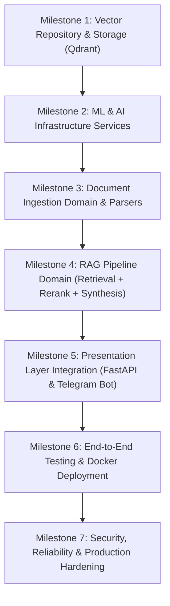

# Implementation Plan — RAG Telegram System 🚀

This document outlines the step-by-step roadmap for implementing the domain-driven RAG system following **Test-Driven Development (TDD)** and **Dependency Inversion (DI)** principles.

---

## 📌 Guiding Principles
1. **Test-Driven Development (TDD):** Every component starts with unit/integration tests establishing expected contracts before writing production code.
2. **Domain Isolation:** Domains (`documents`, `rag`) depend only on abstractions (`VectorRepository`, `EmbeddingService`, `RerankerService`, `LLMService`, `TextSplitterService`).
3. **Pluggable Infrastructure:** External vendor details (Qdrant, FastEmbed, FlashRank, Gemini) live exclusively in `src/infrastructure/` and are resolved via `src/core/dependencies.py`.
4. **Resilient Presentation Layers:** Both FastAPI and Telegram Bot consume domain services directly through dependency injection.

---

## 🧭 Milestone Roadmap

---

## 📋 Detailed Action Plan

### Milestone 1: Vector Repository & Storage Layer (Qdrant)
- [x] **1.1 Unit Tests (`tests/unit/test_qdrant_repository.py`):**
  - Test client initialization and connection handling.
  - Test collection auto-creation if not exists (vector dimension, distance metric: Cosine).
  - Test batch point insertion (`save_chunks`) with payload and embeddings.
  - Test vector similarity search (`search`) with `top_k` and metadata filters.
  - Test document chunk deletion by `document_id`.
- [x] **1.2 Implementation (`src/infrastructure/qdrant/repository.py`):**
  - Implement `QdrantVectorRepository` conforming to `VectorRepository`.
  - Integrate `AsyncQdrantClient` from `qdrant-client`.
  - Handle exceptions and map them to domain `VectorStoreError`.

---

### Milestone 2: ML & AI Infrastructure Services (Embeddings, Reranker, LLM)
- [x] **2.1 FastEmbed Service:**
  - **Tests (`tests/unit/test_fastembed_service.py`):** Test batch text embedding and single query embedding shape and normalization.
  - **Implementation (`src/infrastructure/embeddings/fastembed_service.py`):** Implement `FastEmbedService` conforming to `EmbeddingService` using `fastembed.TextEmbedding`.
- [x] **2.2 FlashRank Service:**
  - **Tests (`tests/unit/test_flashrank_service.py`):** Test candidate reranking, score sorting, and top-N cutoff.
  - **Implementation (`src/infrastructure/rerankers/flashrank_service.py`):** Implement `FlashRankReranker` conforming to `RerankerService` using `flashrank.Ranker`.
- [x] **2.3 Gemini LLM Service:**
  - **Tests (`tests/unit/test_gemini_service.py`):** Test prompt template construction with context chunks, citation handling, and mock API responses.
  - **Implementation (`src/infrastructure/llm/gemini_service.py`):** Implement `GeminiLLMService` conforming to `LLMService` using `langchain-google-genai` (`ChatGoogleGenerativeAI`).

---

### Milestone 3: Document Ingestion Domain
- [x] **3.1 Document Parsers:**
  - **Tests (`tests/unit/test_parsers.py`):** Test `.pdf` extraction (`pypdf`), `.docx` extraction (`python-docx`), and plain `.txt` decoding. Test error handling on corrupted files.
  - **Implementation (`src/domains/documents/parsers.py`):** Implement `PDFParser` and `DocxParser`.
- [x] **3.2 Text Splitter:**
  - Verify and test `LangChainRecursiveSplitter` chunk boundaries and overlap handling with resilient fallback.
- [x] **3.3 Document Service Execution:**
  - **Tests (`tests/unit/test_document_service.py`):** Test full ingestion flow: raw bytes $\to$ parsing $\to$ chunking $\to$ embedding generation $\to$ repository save.
  - **Implementation (`src/domains/documents/service.py`):** Finalize `DocumentService.process_and_index_document`.

---

### Milestone 4: RAG Pipeline Domain
- [x] **4.1 Query Orchestration:**
  - **Tests (`tests/unit/test_rag_pipeline.py`):**
    - Query vectorization call.
    - Candidate retrieval from `VectorRepository` with `top_k`.
    - Candidate reranking via `RerankerService` with `rerank_top_k`.
    - Prompt context assembly and `LLMService` invocation.
    - Empty retrieval edge-cases (graceful answers when no documents match).
  - **Implementation (`src/domains/rag/pipeline.py`):** Finalize `RAGPipelineService.execute_query`.

---

### Milestone 5: Presentation Layers (FastAPI & Telegram Bot)
- [x] **5.1 FastAPI Controllers:**
  - Verify `/api/v1/documents/upload` with multipart file upload.
  - Verify `/api/v1/rag/query` with JSON request/response validation.
  - Add integration tests in `tests/integration/test_api_endpoints.py`.
- [x] **5.2 Telegram Bot Handlers:**
  - Test and implement document download buffer in `src/bot/handlers/documents.py`.
  - Test and implement query handling with markdown citation formatting in `src/bot/handlers/queries.py`.
  - Add error feedback messages for unsupported file formats or empty results.

---

### Milestone 6: Verification, Containerization & CI
- [x] **6.1 Container Environment Validation:**
  - Test build of `Dockerfile` and orchestrate with `docker-compose.yaml` (FastAPI + Bot + Qdrant container).
  - Verify volume persistence for `vector_db_storage`.
- [x] **6.2 Full Test Suite Execution:**
  - Run full test suite: **29 tests passed in Docker container (100% green)**.

---

### Milestone 7: Security, Reliability & Production Hardening
- [ ] Enforce bounded document uploads, supported file formats, and validated chunk/query limits.
- [ ] Protect API routes with a configurable Bearer token and restrict production bot access to an explicit Telegram user allowlist.
- [ ] Add process-local rate limits, safe client-facing errors, and bounded Telegram response formatting.
- [ ] Keep synchronous embedding/reranking off the async event loop; validate embeddings before persistence.
- [ ] Manage Qdrant client lifecycle, readiness probes, container user, internal-only vector DB networking, health checks, and resource/log limits.
- [ ] Add regression tests for validation, authorization, rate limiting, empty retrieval, and error mapping.
